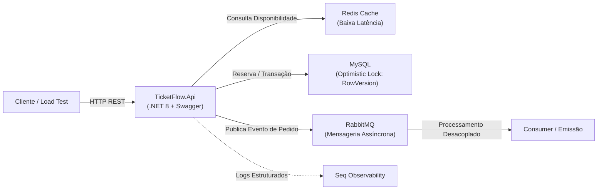

# TicketFlow

> **API RESTful em .NET 8 LTS para gestão de eventos e venda de ingressos sob alta concorrência — prevenindo *overbooking* com Optimistic Concurrency, mensageria assíncrona (RabbitMQ), cache distribuído (Redis) e testes reais com Testcontainers.**

[](https://github.com/TacioMoreira25/TicketFlow/actions/workflows/ci.yml)


---

## Arquitetura & Fluxo de Alta Concorrência

O projeto segue **Clean Architecture** e **SOLID**, separando estritamente domínio, casos de uso e infraestrutura:



### Organização em Camadas
- **`TicketFlow.Domain`**: Entidades ricas, regras de negócio, invariantes de domínio e controle de versão (`RowVersion`).
- **`TicketFlow.Application`**: Casos de uso (*Use Cases*), DTOs e contratos/interfaces desacoplados da infraestrutura.
- **`TicketFlow.Infrastructure`**: Persistência com Entity Framework Core (MySQL), adaptadores de cache (Redis) e mensageria (RabbitMQ).
- **`TicketFlow.Api`**: Controllers REST, middlewares globais, injeção de dependências e documentação OpenAPI/Swagger.
- **`Tests`**: Suíte de testes automatizados (xUnit + FluentAssertions + **Testcontainers** subindo containers reais no CI).

---

## Decisões Técnicas & Trade-offs

| Problema de Engenharia | Decisão Adotada | Por que esta escolha (Trade-off)? |
| :--- | :--- | :--- |
| **Condição de corrida (*Overbooking*)** na compra simultânea do último ingresso | **Optimistic Concurrency** (`RowVersion` via EF Core sobre MySQL) | Mantém alta vazão de leitura sem bloquear linhas no banco sob picos de tráfego, falhando de forma controlada (`DbUpdateConcurrencyException`) em conflitos simultâneos. |
| **Picos de requisições** na confirmação e emissão de ingressos | **Desacoplamento assíncrono via RabbitMQ** | Evita travar o ciclo HTTP esperando processamento secundário, absorvendo rajadas de tráfego com filas duráveis. |
| **Leituras repetitivas** de disponibilidade de eventos | **Cache distribuído com Redis** | Reduz a pressão de I/O no banco relacional em consultas quentes de catálogo/disponibilidade. |
| **Mocks frágeis** que mascaram bugs de concorrência em testes | **Testcontainers (MySQL real no Docker)** | O provedor `EF Core In-Memory` não valida `RowVersion` nem constraints relacionais reais; Testcontainers garante validação fiel no GitHub Actions. |

---

## Como Executar

### 1. Configuração
Copie o arquivo de variáveis de ambiente:
```bash
cp .env.example .env
```

### 2. Rodando com Docker (Stack Completa)
Suba API, MySQL, Redis, RabbitMQ e Seq com um único comando:
```bash
docker compose up -d --build
```

### 3. Rodando Híbrido (Infra Docker + API Local)
1. Suba a infraestrutura:
   ```bash
   docker compose up -d mysql redis rabbitmq seq
   ```
2. Aplique as migrations:
   ```bash
   dotnet ef database update --project TicketFlow.Infrastructure --startup-project TicketFlow.Api
   ```
3. Inicie a API:
   ```bash
   dotnet run --project TicketFlow.Api
   ```

### Acesso aos Serviços
- **Swagger UI:** `http://localhost:5000/swagger`
- **RabbitMQ Management:** `http://localhost:15672` (`guest` / `guest`)
- **Seq (Logs Estruturados):** `http://localhost:5341`

---

## Testes Automatizados

Requer Docker ativo para execução dos testes de integração com Testcontainers:
```bash
dotnet test TicketFlow.sln
```
